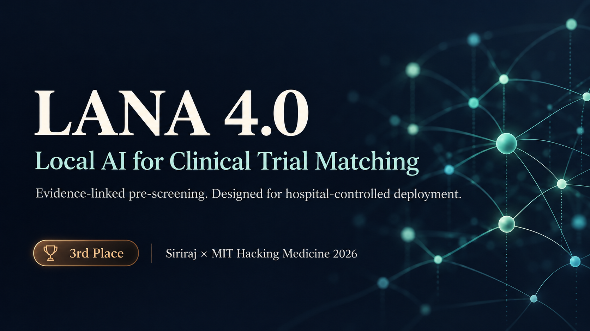
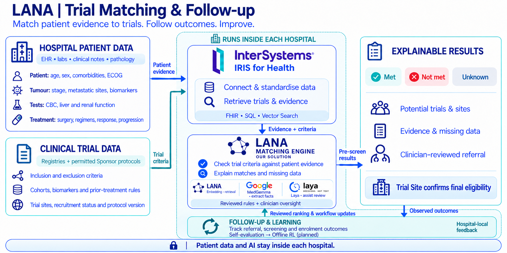
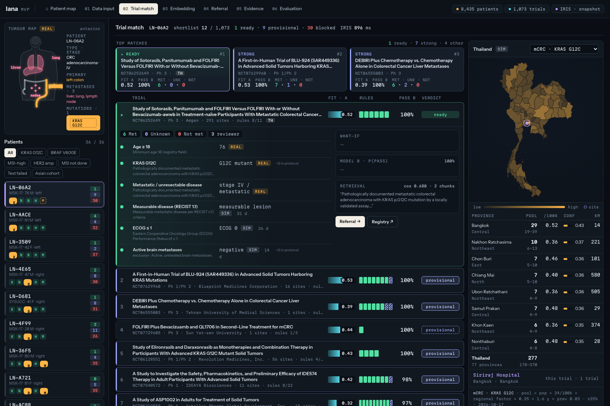
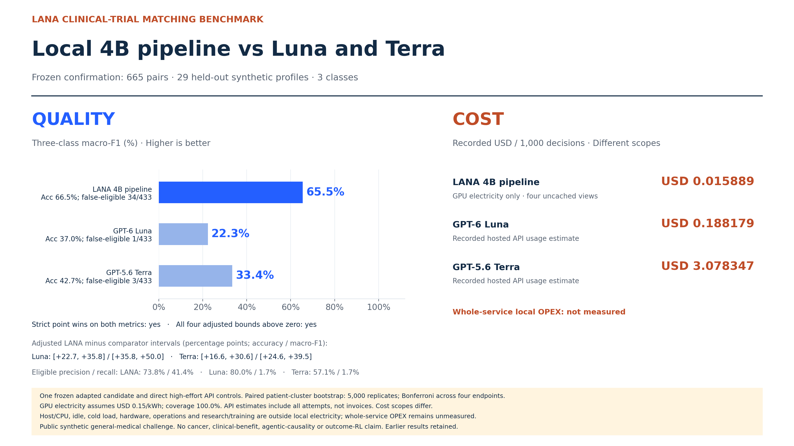

<p align="center">
  
</p>

<p align="center">
  <strong>3rd Place — Siriraj × MIT Hacking Medicine 2026</strong><br>
  Evidence-linked colorectal cancer trial pre-screening, designed for hospital-controlled deployment.
</p>

<p align="center">
  <a href="https://lana-platform-mvp.vercel.app/index.html?p=LN-06A2&t=NCT06252649">Live demo</a> ·
  <a href="docs/architecture.md">Architecture</a> ·
  <a href="benchmarks/README.md">Benchmark</a> ·
  <a href="docs/demo.md">UI walkthrough</a> ·
  <a href="#run-locally">Run locally</a>
</p>

## From patient evidence to a reviewed trial option

Finding a trial takes more than matching a cancer name. A care team must reconcile biomarkers, prior treatments, fitness, laboratory results and protocol exclusions, often across fragmented records.

**LANA connects patient evidence to trial criteria and shows what supports each assessment, what is missing, and what needs clinical review.** The initial product focus is advanced colorectal cancer. A separate research track evaluates a locally adapted MedGemma 1.5 4B model for patient–trial classification.

| For | Intended value |
|---|---|
| Patients and treating teams | A clearer set of trial options, information gaps and next steps |
| Referring hospitals | Evidence-linked pre-screens and referral drafts under hospital control |
| Trial sites | Reviewable evidence packets with unresolved criteria visible |
| Sponsors / CROs | Governed aggregate feasibility across participating hospitals |

These are product objectives. Hospital pilots, referral outcomes and clinical benefit have not been measured.

## How it works



1. **Prepare the evidence.** Keep source facts, simulated demonstration fields, dates and missing tests distinct.
2. **Retrieve and pre-screen.** Shortlist relevant trials; assess supported protocol rules as **Met / Not met / Unknown**.
3. **Review and act.** Show evidence, uncompiled criteria and missing information before a care team considers referral. The Trial Site determines final eligibility.

The diagram depicts the **target hospital-local architecture**, including planned services. The current public demo serves exported snapshots; the source also includes an optional IRIS-backed pipeline. The local 4B benchmark is separate from the UI workflow. [Implementation status →](docs/status.md)

## See the product



Explore the [patient map](https://lana-platform-mvp.vercel.app/index.html?p=LN-06A2&t=NCT06252649), inspect [input provenance](https://lana-platform-mvp.vercel.app/sources.html?p=LN-06A2&t=NCT06252649), or open the [trial-matching example](https://lana-platform-mvp.vercel.app/match.html?p=LN-06A2&t=NCT06252649).

The exported demo reports **8,435 de-identified colorectal records from four public cohorts** and **1,073 trial snapshots**. ECOG, laboratory, imaging and other workflow overlays are simulated and labelled **SIM**. These catalogue counts are distinct from the model benchmark. [All five UI screenshots and data notes →](docs/demo.md)

## Local 4B benchmark

On a frozen **665-pair, three-class research cohort** comprising **29 held-out synthetic profiles**, the task-adapted local pipeline exceeded both direct high-effort API controls on accuracy and macro-F1.

| System | Accuracy | Macro-F1 | Eligible precision | Eligible recall | False eligible / 433 |
|---|---:|---:|---:|---:|---:|
| **LANA adapted MedGemma 4B** | **66.47%** | **65.52%** | 73.85% | 41.38% | 34 |
| GPT-6 Luna · direct high | 36.99% | 22.32% | 80.00% | 1.72% | 1 |
| GPT-5.6 Terra · direct high | 42.71% | 33.44% | 57.14% | 1.72% | 3 |



LANA found **96 of 232 eligible pairs**, versus four for each control, while producing more false-eligible predictions. All four adjusted patient-cluster confidence intervals for the accuracy/F1 differences were positive. This compares an adapted local system with direct API systems under different learning/compute budgets; it does not prove a stronger foundation model, colorectal clinical accuracy, or a causal benefit from agents or RL.

Recorded local GPU electricity was **$0.015889 per 1,000 decisions**. Hosted API usage estimates were **$0.188179** for Luna and **$3.078347** for Terra. **These have different cost scopes; whole-service local OPEX is unmeasured.**

[Method, statistics, costs, earlier negative findings and limitations →](benchmarks/README.md) · [665 published prediction rows →](benchmarks/results/confirmation-665/predictions.jsonl)

## Run locally

The static snapshot needs only Python 3.11+. No API key, model download or IRIS instance is required.

```bash
git clone https://github.com/modellismz/lana-clinical-trial-matching.git
cd lana-clinical-trial-matching
python3 -m http.server 8011 --bind 127.0.0.1 --directory apps/platform/web
```

Open [localhost:8011](http://localhost:8011/index.html?p=LN-06A2&t=NCT06252649).

Replay the published model metrics without a GPU or API calls:

```bash
python3 benchmarks/replay.py
python3 benchmarks/replay.py --bootstrap
```

For the optional IRIS/data-processing pipeline, see [the application guide](apps/platform/README.md). The [frozen MedGemma research kernel](research/README.md) is supplied for inspection; the adapted checkpoint and complete training bundle are not distributed here. Metric replay reproduces the reported calculations, not the original inference.

## What is next

- Connect and evaluate the local MedGemma service within the product workflow.
- Validate broader protocol coverage, retrieval misses and colorectal eligibility against clinician-reviewed cases.
- Pilot authorised hospital integration and referral review.
- Collect site-confirmed screening/enrolment outcomes before evaluating offline learning.

[Full roadmap and status →](docs/status.md) · [Required inputs and outputs →](docs/inputs-and-outputs.md) · [Data custody and disclosure →](docs/data-governance.md)

## Repository

```text
apps/platform/       Public-data UI, rules, IRIS access and optional pipeline
assets/              Reviewed cover, logo diagrams, benchmark and UI screenshots
benchmarks/          Methodology, frozen predictions, statistics and CPU replay
research/            Hash-matched MedGemma experiment kernel and model notes
docs/                Architecture, demo, inputs, status and data governance
scripts/             Repository checks
```

## Credits and licensing

Built for **Siriraj × MIT Hacking Medicine 2026**, where the team placed **third**. Technologies include InterSystems IRIS, Google MedGemma, BGE-M3, Python and FastAPI. Laya, Langfuse and vLLM appear in the proposed service design; their integration status is documented separately.

The application source is derived from [lana-platform-mvp](https://github.com/modellismz/lana-platform-mvp). Thanks to the public-data and research communities behind cBioPortal, ClinicalTrials.gov and the TREC Clinical Trials track. [Source provenance and acknowledgements →](docs/provenance.md)

This public research prototype is a pre-screening aid, not an eligibility determination or a clinically validated medical device. Project code, upstream models, data and service marks have separate terms. See [LICENSE](LICENSE) and [NOTICE](NOTICE.md).
