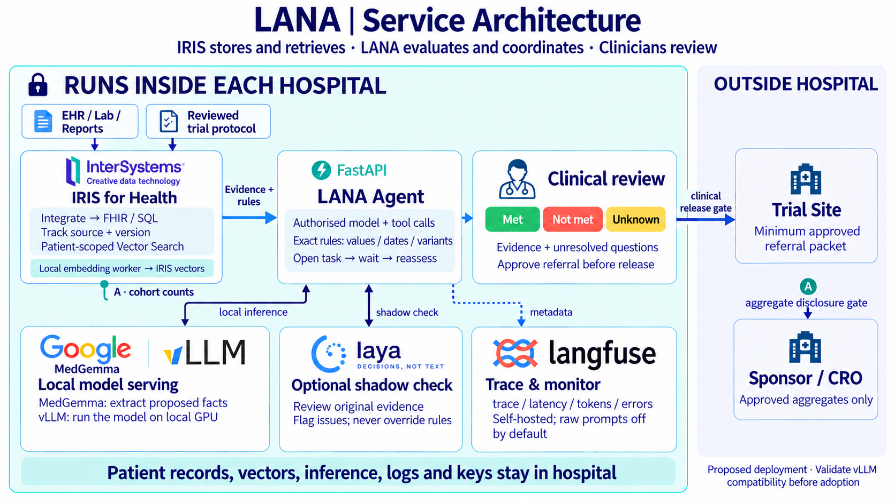
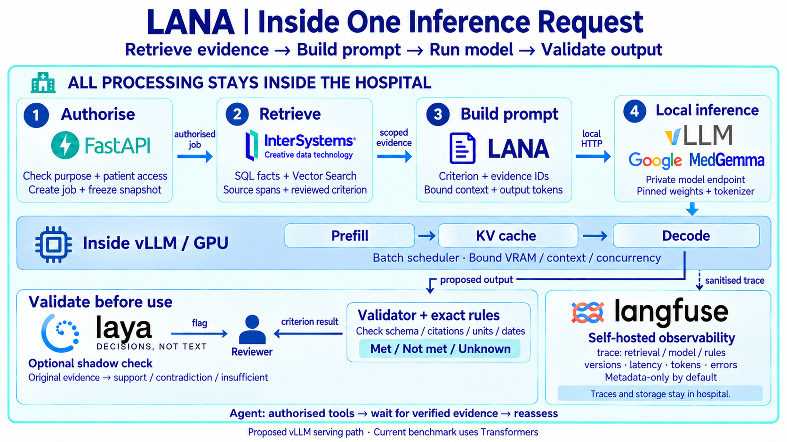
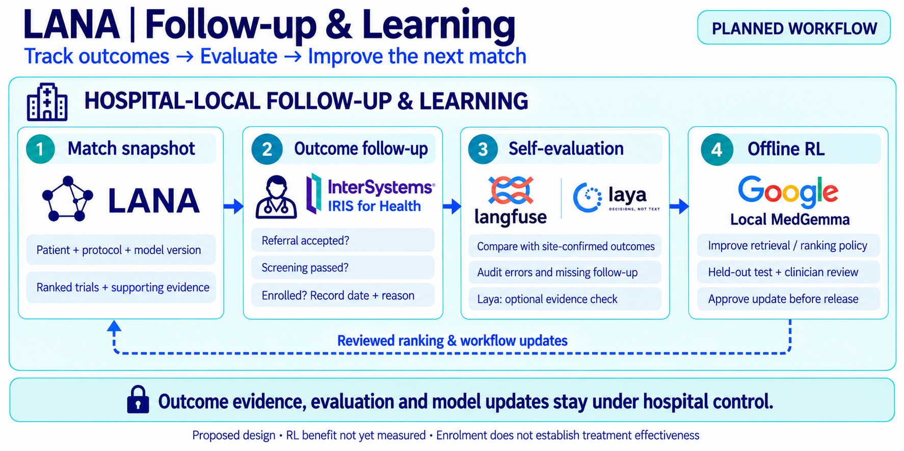

# Architecture

The product design joins two distinct inputs: hospital patient evidence and versioned clinical-trial criteria. InterSystems IRIS supplies the data/retrieval foundation; LANA coordinates evidence assessment; clinicians review potential referrals.

These images describe the **target deployment**. The public UI uses exported snapshots, and the published 4B model experiment runs separately. No production hospital connector or end-to-end sovereignty certification is established by the benchmark.

## High level

The full patient-input contract, including TNM, brain metastases, surgical margins and prior treatment failures, is retained in [Inputs and outputs](inputs-and-outputs.md).

## Service responsibilities

| Component | Responsibility | Current evidence / status |
|---|---|---|
| IRIS | SQL/vector retrieval and provenance foundation | Optional application pipeline and `VECTOR_COSINE` queries are in source; live hospital connectivity is not established |
| BGE-M3 | Local patient/trial embeddings | Present in the prototype pipeline; not a separately trained LANA embedding checkpoint |
| LANA application | Rule assessment, ranking, missing-data display and referral draft | Public-data snapshot and source code included |
| MedGemma 1.5 4B | Locally adapted patient–trial classification | Separately benchmarked; not the deployed UI's Model A/B |
| FastAPI | Optional live prototype API | Present in source; requires prepared data, model artifacts and IRIS |
| vLLM | Proposed production serving endpoint | Compatibility and deployment require validation; benchmark used Transformers/NF4 |
| Laya | Optional second evidence check | Proposed; no measured incremental benefit |
| Langfuse | Proposed self-hosted traces | Proposed; traces do not supply clinical ground truth |
| Clinical reviewers / Trial Site | Verify evidence, review referral, determine eligibility | Authority boundary in the design; no live referral integration claimed |

## One inference request

1. Authorise purpose and patient scope; freeze the evidence snapshot.
2. Retrieve source facts and the relevant reviewed criterion.
3. Build a bounded prompt with evidence identifiers.
4. Run local inference; retain model and rule versions.
5. Check output structure, citations, units, dates and exact rules before review.

The illustrated vLLM path is proposed. The frozen benchmark used four uncached class-scoring views with Transformers/NF4; its prespecified selected readout was the source view. A production single-view serving cost has not been measured.

## Follow-up and learning

Collect referral, formal screening and enrolment events with date, reason, source and observation window. Pending or absent follow-up is not automatically failure. Compare recommendations with independently documented site/clinician outcomes, then consider reviewed retrieval/ranking or workflow updates.

RL is a proposed research direction. It must not rewrite protocol thresholds or bypass Trial Site eligibility decisions. Enrolment does not establish treatment effectiveness, and LLM agreement is not outcome ground truth.

## Diagram sources

The selected PNG artwork comes from the team's reviewed imagegen editions. The [Mermaid files](diagrams/) are semantic companions, not editable sources for the raster artwork. The [cover and follow-up prompts](image-prompts/) are retained. Technology logos identify components, not partnerships or endorsements.
