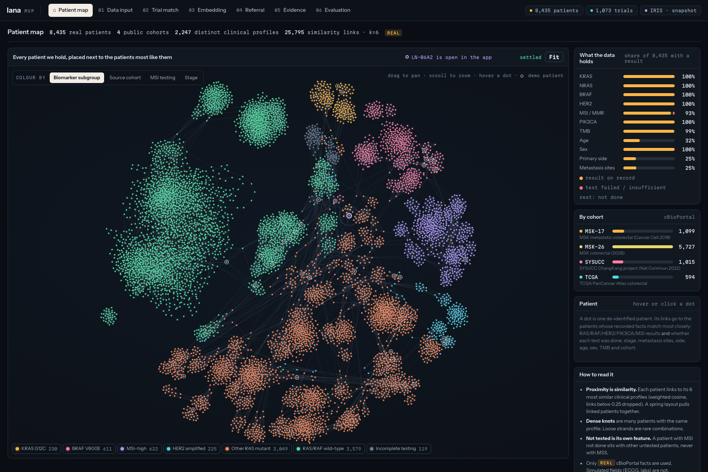
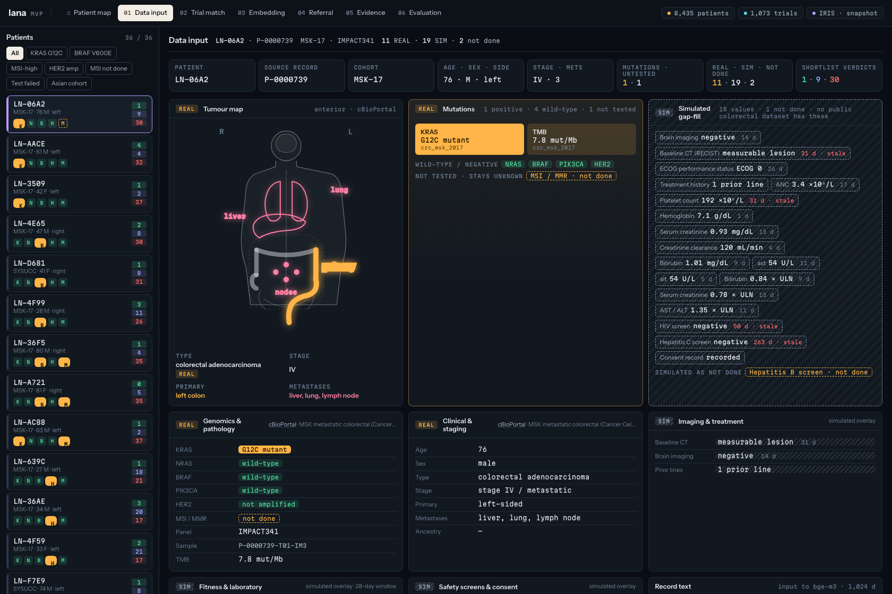
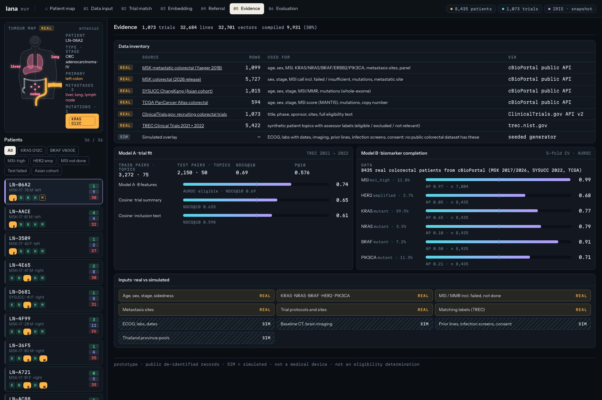
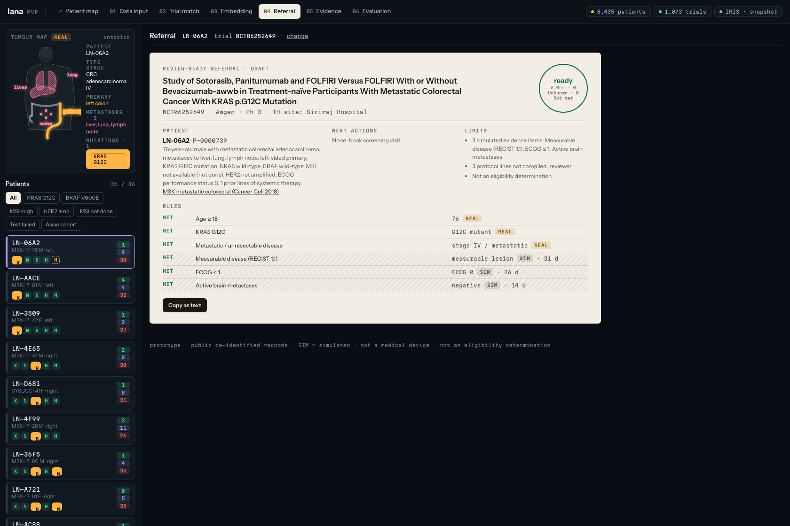

# Product walkthrough

[Open the live demo](https://lana-platform-mvp.vercel.app/index.html?p=LN-06A2&t=NCT06252649). These are the reviewed, unmodified screenshots of the public snapshot. They do not imply that a live hospital or local MedGemma service is connected to the hosted site.

## 1. Explore the patient map

The UI reports 8,435 de-identified records across four public cohorts. The graph groups similar recorded clinical profiles; proximity does not establish treatment benefit or trial eligibility. The final capture waited for the layout to settle and used the Fit control.

## 2. Inspect the inputs

Genomic and clinical source records are separated from simulated ECOG, laboratory, imaging and other workflow values. Keep REAL/SIM and missing-test states visible when presenting the demo.

## 3. Review trial matches

The example opens patient `LN-06A2` and trial `NCT06252649`. “Ready” and “pass” are prototype outputs with coverage limits, not a validated eligibility probability. The Thailand province pools are modelled/SIM; they are not observed counts of eligible patients.

## 4. Check evidence and metrics

The Evidence page's Model A/B metrics describe the prototype's retrieval/ranking and biomarker tasks. They are separate from the [665-pair MedGemma comparison](../benchmarks/README.md), and have not been independently re-estimated in this repository release.

## 5. Read the referral draft

The draft retains the evidence sources, SIM labels and uncompiled-criterion limits. Clinical review and Trial Site confirmation remain necessary.

## Capture provenance

All five UI images are byte-identical to the reviewed captures. Their publication hashes and dimensions are in [the asset manifest](../assets/manifest.json). Source routes are `index.html`, `sources.html`, `match.html`, `evidence.html` and `referral.html` on the linked demo, with the same patient/trial query parameters. Screenshots were captured at 1680×1120 on 23 October 2026 UTC.
